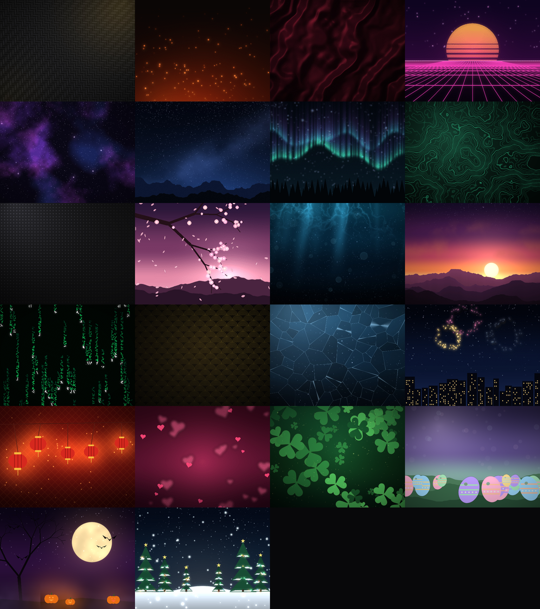

# HyperionLooks

Background pictures of the HyperionElite **Ready-made looks** (Quick Access > Theme, Settings > Theme & Sharing) and the **event looks**.
The hub downloads a picture from `raw.githubusercontent.com` the first time a look is applied and keeps it in `HYPERIONELITE/Backgrounds`.

Every picture is original: `make_looks.py` draws all of them from code (gradients, noise, light, particles, shapes). Run `python make_looks.py .` to draw them again.
Stills are 1024 x 768 (drawn at 2048 x 1536 and reduced), animated looks 256 x 192 x 20 frames (drawn at 512 x 384), seamless loops.

## Event looks: on or off for everyone

`config.json` decides whether the event looks switch on by themselves on their dates (each player can still turn them off in Settings > Theme):

```json
{ "events": true }
```

Set `"events": false` to stop them for everyone (players' own looks come back on their next run). `"force": "christmas"` (any event id) shows that event
look today, for a test; leave it `""` normally. The hub reads this file at every run (GitHub may take a few minutes to serve an edit).

| event | id | dates |
|---|---|---|
| Christmas | christmas | Dec 1 - Dec 26 |
| New Year | newyear | Dec 27 - Jan 3 |
| Valentine | valentine | Feb 10 - Feb 15 |
| Lunar New Year | lunar | 3 days before to 7 days after the Lunar New Year |
| St Patrick | clover | Mar 14 - Mar 18 |
| Easter | easter | Palm Sunday to Easter Monday |
| Halloween | halloween | Oct 20 - Nov 1 |

## Pictures

| look | file | kind |
|---|---|---|
| carbon | `looks/carbon_v3.jpg` | still, 1024 x 768 |
| ember | `looks/ember_v3.gif` | animated GIF, 256 x 192 x 20 |
| velvet | `looks/velvet_v3.jpg` | still, 1024 x 768 |
| synthwave | `looks/synthwave_v3.gif` | animated GIF, 256 x 192 x 20 |
| nebula | `looks/nebula_v3.jpg` | still, 1024 x 768 |
| midnight | `looks/midnight_v3.jpg` | still, 1024 x 768 |
| aurora | `looks/aurora_v3.gif` | animated GIF, 256 x 192 x 20 |
| jade | `looks/jade_v3.png` | still, 1024 x 768 |
| mono | `looks/mono_v3.png` | still, 1024 x 768 |
| sakura | `looks/sakura_v3.gif` | animated GIF, 256 x 192 x 20 |
| abyss | `looks/abyss_v3.jpg` | still, 1024 x 768 |
| dusk | `looks/dusk_v3.jpg` | still, 1024 x 768 |
| terminal | `looks/terminal_v3.gif` | animated GIF, 256 x 192 x 20 |
| royal | `looks/royal_v3.jpg` | still, 1024 x 768 |
| glacier | `looks/glacier_v3.jpg` | still, 1024 x 768 |
| newyear (event) | `looks/newyear_v3.gif` | animated GIF, 256 x 192 x 20 |
| lunar (event) | `looks/lunar_v3.gif` | animated GIF, 256 x 192 x 20 |
| valentine (event) | `looks/valentine_v3.gif` | animated GIF, 256 x 192 x 20 |
| clover (event) | `looks/clover_v3.jpg` | still, 1024 x 768 |
| easter (event) | `looks/easter_v3.jpg` | still, 1024 x 768 |
| halloween (event) | `looks/halloween_v3.gif` | animated GIF, 256 x 192 x 20 |
| christmas (event) | `looks/christmas_v3.gif` | animated GIF, 256 x 192 x 20 |

`thumbs_v3.png` holds the card previews (256 x 160 cells, four columns, in the order above). `brand/` holds the Hyperion emblem of the top bar.


